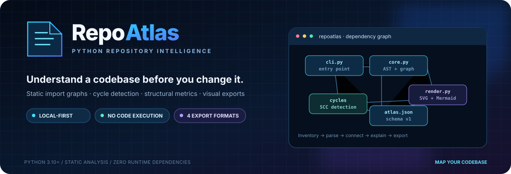
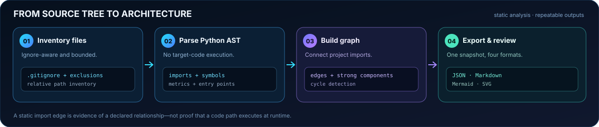
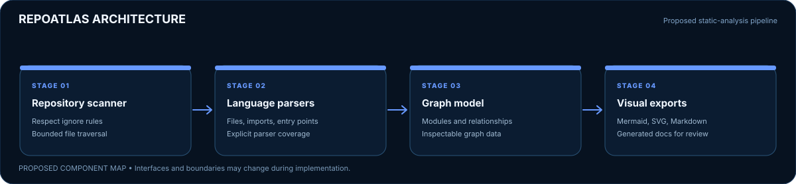
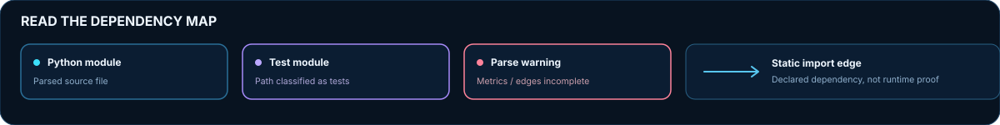

# RepoAtlas

  

<strong>Understand a codebase before you change it.</strong> Static import graphs · cycle detection · structural metrics · beautiful, portable exports

  <a href="#quick-start">Quick start</a> · <a href="docs/ARCHITECTURE.md">Architecture</a> · <a href="docs/USAGE.md">Usage</a> · <a href="docs/ROADMAP.md">Roadmap</a>

  
  
  
  
  

> **Status: v0.1.0 alpha.** RepoAtlas now has an executable Python CLI, static import graph, cycle detection, structural metrics, JSON snapshots, Markdown reports, Mermaid diagrams, and standalone SVG exports. Multi-language analysis and interactive graph navigation are not included yet.

RepoAtlas is a local-first **Python repository mapper and architecture visualizer**. It inventories files, parses Python modules with the standard-library AST, resolves visible internal imports, detects strongly connected import cycles, and exports a reusable snapshot with visual diagrams for code reviews and project documentation.

The scanner does not import or run target code, and it does not make network requests.

## What you get

| Capability | Output | Developer value |
|---|---|---|
| Repository inventory | Relative paths, categories, file sizes | Understand repository shape quickly |
| AST metrics | Lines, functions, classes, docstring summary | Find complex or important modules |
| Internal dependency graph | Directed edges, import lines, in/out degree | Navigate declared code relationships |
| Cycle detection | Strongly connected import groups | Find coupling worth reviewing |
| Entry-point signals | Main guards, __main__.py, detected console scripts | Locate likely execution paths |
| Structural findings | Missing README, parse warnings, cycle signals | Turn a scan into a review checklist |
| Visual exports | Markdown, Mermaid, SVG, JSON | Share the same analysis in docs, code reviews, and automation |
| Bounded local scan | Ignore rules, exclusions, source/file limits | Keep scans predictable and reviewable |

## Visual workflow

## Architecture at a glance

## Quick start

### 1. Install

Python 3.10 or newer is required. Runtime operation has zero mandatory third-party dependencies.

~~~bash
git clone https://github.com/muhammadsaeed-ai/RepoAtlas.git
cd RepoAtlas
python -m venv .venv
~~~

Activate the environment, then install the package.

**Windows PowerShell**

~~~powershell
.\\.venv\\Scripts\\Activate.ps1
python -m pip install .
~~~

**macOS / Linux**

~~~bash
source .venv/bin/activate
python -m pip install .
~~~

### 2. Scan a repository

~~~bash
repoatlas scan /path/to/your/project --output atlas.json
~~~

Or scan the current directory:

~~~bash
repoatlas scan . --output atlas.json
~~~

Example terminal summary (illustrative, not measured benchmark data):

~~~text
RepoAtlas scan complete: my-project
Files: 842 | Python modules: 126 | Internal edges: 318 | Cycles: 2
Snapshot: /path/to/atlas.json
Static analysis only: project code was not executed; no network requests were made.
~~~

### 3. Export polished artifacts

~~~bash
repoatlas render atlas.json --format markdown --output atlas-report.md
repoatlas render atlas.json --format mermaid --output dependency-graph.mmd
repoatlas render atlas.json --format svg --output dependency-map.svg
~~~

The JSON snapshot can be rendered repeatedly without rescanning the repository.

## Try the demo project

~~~bash
repoatlas scan examples/demo_project --output /tmp/demo-atlas.json
repoatlas render /tmp/demo-atlas.json --format markdown
repoatlas render /tmp/demo-atlas.json --format svg --output /tmp/demo-atlas.svg
~~~

Open the SVG in a browser or vector editor. The sample intentionally includes a small import cycle so the analyzer can demonstrate a structural warning; it is a diagnostic fixture, not ideal architecture.

## Read the graph

- **Node:** an inventoried Python module or package initializer.
- **Arrow:** a declared import that resolves to a module inside the scanned repository.
- **Cycle:** a strongly connected group of modules that import each other directly or indirectly.
- **In-degree:** distinct modules importing a given module.
- **Out-degree:** distinct project modules imported by a module.
- **External import root:** not resolved to this repository or the standard-library module set. It does not prove that an external package is installed.
- **Finding:** a rule-driven review signal, not an automated quality score.

## Scan controls

~~~bash
repoatlas scan . --exclude "generated/**" --exclude "*.snap"
repoatlas scan . --max-files 20000 --max-python-bytes 1048576 --output atlas.json
repoatlas scan . --output -
repoatlas render atlas.json --format markdown --output atlas-report.md --force
~~~

Common generated folders are excluded by default and root/nested .gitignore patterns are honored using a practical subset of Git semantics. Existing outputs are not overwritten unless --force is passed.

## Privacy and safety

- Target modules are never imported or executed.
- The scanner makes no network requests and performs no source upload.
- Snapshots contain repository-relative paths, not the absolute root path.
- Python source is parsed locally but source contents are never embedded in JSON.
- Symlinked files and directories are skipped rather than followed.
- File count, source reads, snapshot loading, and graph exports have limits.
- Reports can still reveal module names, relative paths, docstrings and dependencies. Review before sharing outside your team.

See [Security policy](SECURITY.md) and [Architecture](docs/ARCHITECTURE.md).

## Verification

CI is configured for Python 3.10–3.14 on Ubuntu, Windows, and macOS. The matrix is only considered verified after GitHub Actions finishes successfully.

~~~bash
python -m pip install -e ".[dev]"
python -m pytest
python -m ruff check src tests examples
python -m ruff format --check src tests examples
python -m build
~~~

## Current boundaries

RepoAtlas v0.1.0 parses Python only. Other languages appear in the file inventory but do not receive dependency analysis. Interactive graph browsing, runtime tracing, semantic architecture inference, and proof that external dependencies are installed are not included.

See the [roadmap](docs/ROADMAP.md) for future work.

## Contributing

Reproducible parser edge cases, graph correctness tests, import-resolution examples, and accessibility improvements are especially useful. Read [CONTRIBUTING.md](CONTRIBUTING.md) and [SECURITY.md](SECURITY.md) before contributing. Never submit private source code or unreviewed graph exports.

## License

MIT. See [LICENSE](LICENSE).

## GitHub topics and discovery keywords

Suggested topics: python, codebase-analysis, repository-analysis, static-analysis, architecture-visualization, dependency-graph, import-graph, developer-tools, code-documentation, mermaid, software-architecture, repository-map.

These terms describe actual project scope and may improve discovery; search ranking or traffic is not guaranteed.
