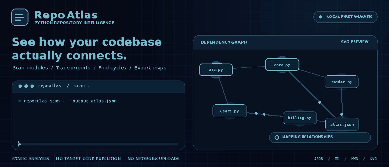
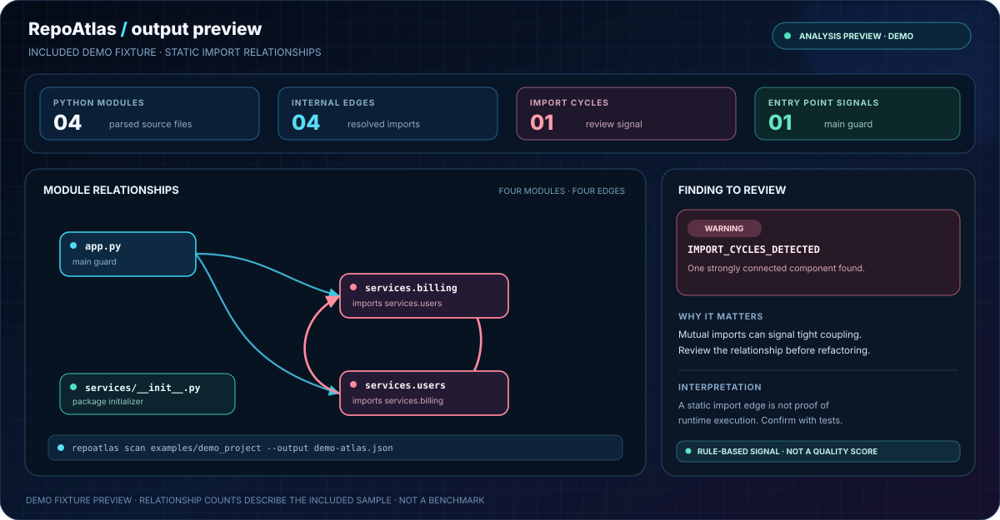

  

<h1 align="center">Your codebase has a map. Find it.</h1>

  <strong>RepoAtlas turns an unfamiliar Python repository into an inspectable map of modules, imports, cycles, and structural signals.</strong> 
  Scan locally. Understand the connections. Make changes with better context.

Built and maintained by <a href="https://verityagent.lovable.app"><strong>VerityAgent</strong></a> · AI agents, automation, and developer tools

  <a href="#quick-start">⚡ Quick start</a> &nbsp;·&nbsp;
  <a href="#see-the-map">See the map</a> &nbsp;·&nbsp;
  <a href="docs/ARCHITECTURE.md">Architecture</a> &nbsp;·&nbsp;
  <a href="docs/USAGE.md">Full usage</a>

  
  
  
  

> **v0.1.0 alpha · Python static analysis · zero mandatory runtime dependencies.** RepoAtlas reads and parses selected Python source locally. It does not import or execute your project modules and does not upload your code.

---

## The hook: stop exploring a repository blind

A folder tree tells you **what exists**. RepoAtlas adds a first-pass view of **how Python modules connect**—including import cycles, likely entry points, and files that need a closer look.

<blockquote>
  <strong>One command in. Four useful artifacts out.</strong> 
  JSON snapshot for tools · Markdown report for people · Mermaid for documentation · SVG for a visual map.
</blockquote>

## See the map

  

Demo-fixture preview. The relationships and counts come from the included sample project; the composition is a curated illustration of the output model, not a screenshot of a GUI application.

### What RepoAtlas actually inspects

| Signal | How it helps |
|---|---|
| **Module map** | Explore declared internal imports instead of inferring relationships from filenames. |
| **Cycle detection** | Find strongly connected import components worth reviewing for tight coupling. |
| **Structural metrics** | See file inventory, line counts, classes, functions, and module connectivity. |
| **Entry-point signals** | Find Python main guards, __main__.py, and supported project console-script declarations. |
| **Actionable findings** | Review parse warnings, missing README signals, and other explicitly rule-based observations. |
| **Portable artifacts** | Keep one versioned snapshot, then render reports and diagrams without rescanning. |

## Quick start

### 1. Install RepoAtlas

Python 3.10 or newer is required. The runtime has **zero mandatory third-party dependencies**.

~~~bash
git clone https://github.com/muhammadsaeed-ai/RepoAtlas.git
cd RepoAtlas
python -m venv .venv
~~~

Activate the environment, then install the CLI.

**Windows PowerShell**
~~~powershell
.\.venv\Scripts\Activate.ps1
python -m pip install .
~~~

**macOS / Linux**
~~~bash
source .venv/bin/activate
python -m pip install .
~~~

### 2. Scan a repository

~~~bash
repoatlas scan /path/to/your/project --output atlas.json
~~~

### 3. Export an architecture map

~~~bash
repoatlas render atlas.json --format markdown --output atlas-report.md
repoatlas render atlas.json --format mermaid --output dependency-graph.mmd
repoatlas render atlas.json --format svg --output dependency-map.svg
~~~

Open dependency-map.svg in a browser or vector editor. Mermaid output can be embedded into GitHub Markdown. The JSON snapshot can be rendered repeatedly without scanning the source again.

## Try the included demo

The repository includes a deliberately small example with a cycle so you can inspect a known case:

~~~bash
repoatlas scan examples/demo_project --output demo-atlas.json
repoatlas render demo-atlas.json --format markdown
repoatlas render demo-atlas.json --format svg --output demo-map.svg
~~~

The included fixture has four Python modules and a deliberate cycle between its services.billing and services.users modules. It demonstrates how a structural signal is surfaced; it is **not** an example of ideal architecture.

## Trust is a feature, not a badge

| Local-first | Evidence-led | Bounded |
|:---:|:---:|:---:|
| No source uploads or scanner network requests | Findings are rule-based signals, not invented quality scores | File-count, source-size, snapshot, and graph limits |
| Target modules are not executed | Static imports are not misrepresented as runtime traces | Existing output files require explicit --force to overwrite |

### What the graph means—and what it does not

  

A directed edge means RepoAtlas found a declared import that it could resolve to a module in the selected repository. It is **not** proof that the code path runs at runtime. Dynamic imports, reflection, plugin discovery, generated modules, and unusual package layouts can be missed.

The current release analyzes **Python syntax only**. Other files are inventoried but do not receive language-specific dependency analysis. Interactive graph navigation, runtime tracing, and semantic architecture inference are not implemented features.

## Built for reviewable engineering

  

- **Repeatable snapshots:** one schema-versioned JSON model is the source for every renderer.
- **Safer by default:** target code is not imported or executed; symlinks are skipped and source reads are bounded.
- **Review before sharing:** snapshots avoid absolute scan-root paths and source text, but names, relative paths, dependencies, and opt-in docstring summaries can still expose project structure.
- **No silent clobbering:** existing outputs require an explicit --force flag.
- **Honest limitations:** results are navigation and review evidence, not a substitute for runtime tests or a full language-server analysis.

## Quality checks

The CI workflow tests Python 3.10–3.14 across Ubuntu, Windows, and macOS. A green badge reflects the workflow's latest run; it is not a claim of formal certification or a benchmark result.

Run the checks locally:

~~~bash
python -m pip install -e ".[dev]"
python -m pytest
python -m ruff check src tests examples
python -m ruff format --check src tests examples
python -m build
~~~

## Documentation

| Guide | Purpose |
|---|---|
| [Architecture](docs/ARCHITECTURE.md) | Component boundaries, graph model, safety constraints, and limitations |
| [Usage guide](docs/USAGE.md) | CLI commands, snapshot workflow, and interpretation |
| [Roadmap](docs/ROADMAP.md) | Proposed work separated from implemented capabilities |
| [Contributing](CONTRIBUTING.md) | Tests, engineering constraints, and pull-request checklist |
| [Security policy](SECURITY.md) | Safe reporting and data-handling notes |
| [Changelog](CHANGELOG.md) | Version history |

## Contribute

Help make codebase exploration more accurate: import-resolution edge cases, parser fixtures, cycle analysis, accessibility, and graph readability are especially valuable. Start with [CONTRIBUTING.md](CONTRIBUTING.md).

## Search terms

Suggested GitHub topics: python, codebase-analysis, repository-analysis, static-analysis, architecture-visualization, dependency-graph, import-graph, developer-tools, code-documentation, mermaid, software-architecture.

These keywords describe the real project scope; no search-ranking or traffic outcome is guaranteed.

  <strong>RepoAtlas · See the connections before you change the code.</strong>

